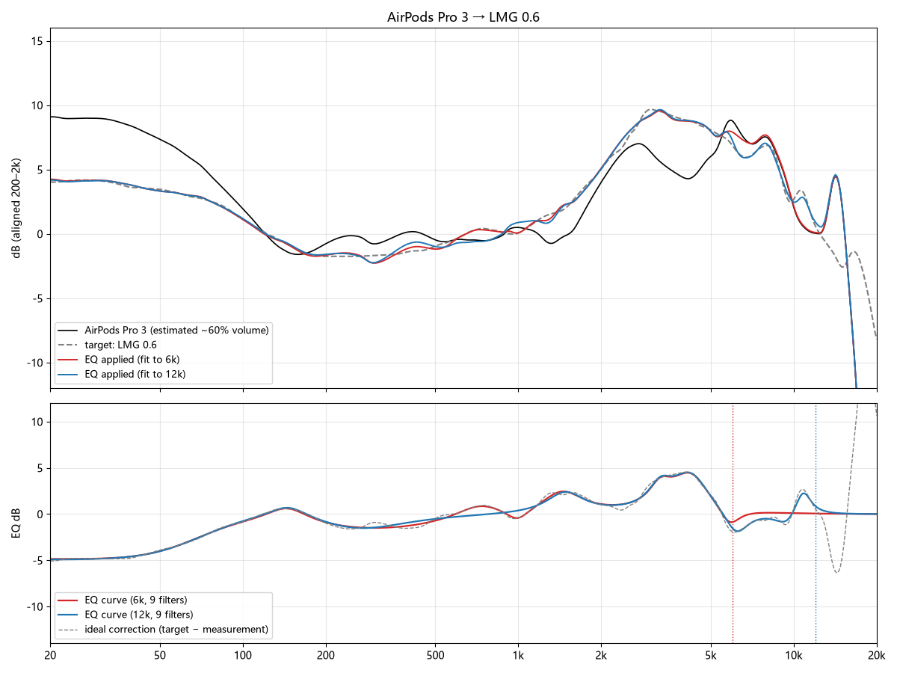
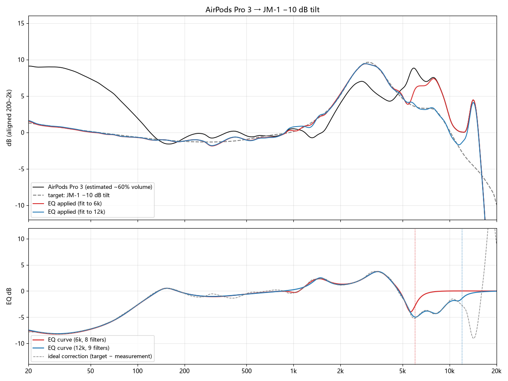
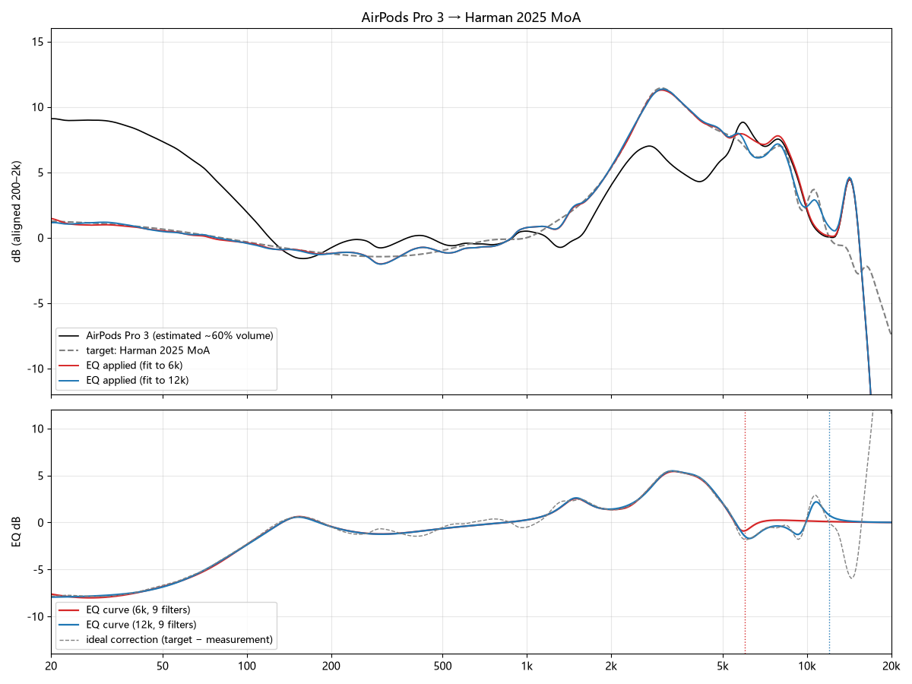
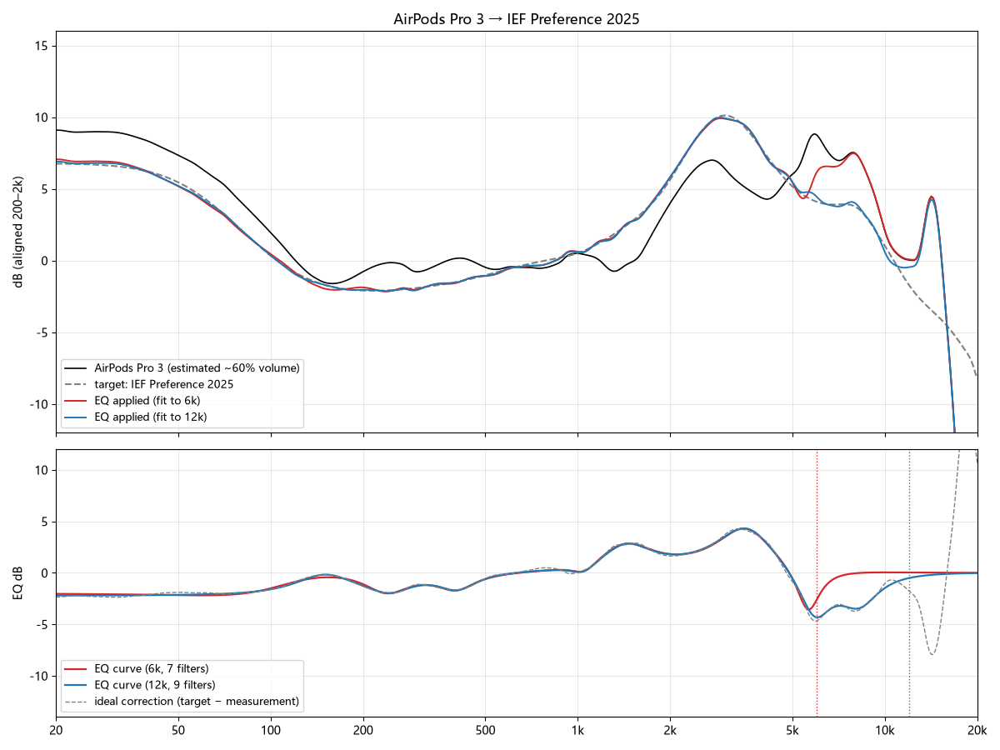
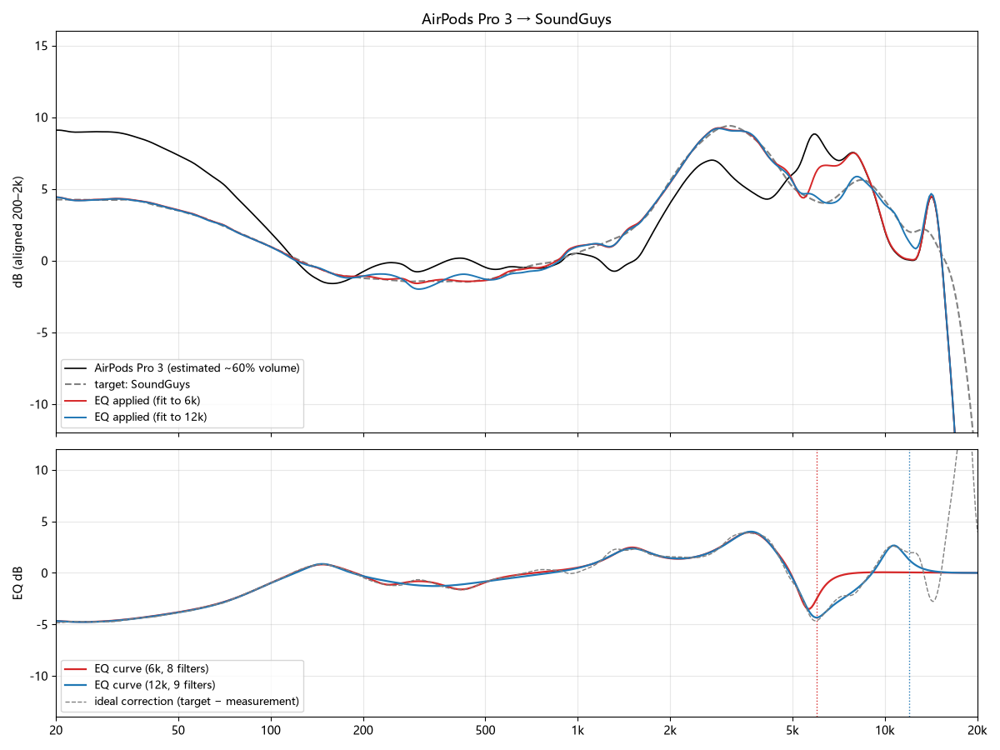

# AirPods Pro 3 PEQ (≈60% volume, fitted to B&K 5128 measurements)

**English** | [中文](README.zh-CN.md)

Parametric EQ (PEQ) presets that fit the AirPods Pro 3 response to several popular target curves: LMG 0.6, JM-1 −10 dB tilt, Harman 2025 MoA, IEF Preference 2025 and SoundGuys. Each target has a 6 kHz and a 12 kHz fit-range version.

> **Note:** the measurement used here is a **≈60% volume estimate** built from several B&K 5128 measurements, not a measurement of your own unit. Firmware, ear tips, fit, noise cancelling state and volume all change the response. Treat these presets as a starting point, not a reference.

## Fit results

Each plot shows the estimated measurement (black), the target (dashed grey), the response after EQ at 6 kHz (red) and 12 kHz (blue), and the EQ curves with the ideal correction (target − measurement).

### LMG 0.6

### JM-1 −10 dB tilt

### Harman 2025 MoA

### IEF Preference 2025

### SoundGuys

## Files

| Path | Content |
|---|---|
| `presets/*.txt` | PEQ filters in Equalizer APO format (`Preamp` + `Filter N: ON ...`) |
| `plots/fit_*.png` | Fit result for each target |

Naming: `<target>_<range>.txt`, e.g. `LMG06_12k.txt` = LMG 0.6 target, fit up to 12 kHz.

## Usage

1. Import a preset into an app that reads Equalizer APO format (Equalizer APO on Windows, Peace, etc.). Not every Android app accepts this format. Check before relying on one.
2. Set the `Preamp` value too. It leaves headroom for the boosted bands and avoids clipping.
3. Start with the 12 kHz versions. The 6 kHz versions leave everything above 6 kHz untouched, which is more conservative.
4. When comparing presets, **keep the volume the same**. The presets are loudness-matched, but that matching is estimated from pink noise, so ±0.5 dB of perceived difference is normal.

## Targets

| Preset prefix | Target | Notes |
|---|---|---|
| `LMG06_*` | LMG 0.6 | B&K 5128 target from LTT Labs, leaning toward preference |
| `JM1-10dB_*` | JM-1 −10 dB tilt | JM-1 5128 target with a −1 dB/octave tilt (darker than the plain JM-1) |
| `Harman25_*` | Harman 2025 MoA | Harman 2025 average target |
| `IEF25_*` | IEF Preference 2025 | Preference-oriented version of JM-1 with extra bass and less treble |
| `SoundGuys_*` | SoundGuys | SoundGuys 5128 target |

Target data belongs to its publishers. This repo only contains the fitted PEQ parameters, not the original target data.

## Data sources (raw data is not included)

| Source | URL | Used for |
|---|---|---|
| earphonesarchive | https://earphonesarchive.squig.link/ | B&K 5128 measurements of AirPods Pro 3 (iPhone, vol-4, ANC on/off, transparency) and some targets |
| Hangout / Crinacle 5128 | https://graph.hangout.audio/iem/5128 | 5128 measurements of AirPods Pro 3 (macOS, Windows, multiple seatings) and the LMG 0.6, JM-1, Harman 2025, IEF 2025 and SoundGuys targets |
| headphones.com GraphWorks | https://headphones.com/ (product slug `airpods-pro-3`) | 16 volume-setting 5128 measurements (measurement ID `cmqtqbexe000004jv2mqogkh0`) |
| squig.link | https://squig.link/ | 711 coupler measurements. Not 5128. Used only to estimate how the response changes with volume |

Deep links to the individual entries were not recorded. Search each site for `AirPods Pro 3` or `5128`. Data was retrieved in 2026-11 and may have changed since.

## Method

- **Measurement baseline:** the 5128 measurements from several sources are aligned at 200 Hz–2 kHz and combined. The response is then adjusted to ≈60% volume using the volume changes seen in the other sources.
- **Fit target:** target − measurement, fitted to the error smoothed at 1/6 octave.
- **Filters:** 1 low shelf + 8 peaking filters. The EQ is held at 0 dB above the fit range.
- **Regularisation:** a squared penalty of 0.3 per dB of gain stops the optimiser from cancelling large boosts and cuts against each other. After fitting, duplicate filters (same frequency and Q) are merged and the remaining filters are refitted once.
- **Error:** RMS error inside the fit range is mostly 0.1–0.6 dB. The 10–12 kHz band reaches about 0.6 dB in the 12 kHz versions.

## Not included

- Raw measurement data and raw target CSVs (see the sources table above)
- The version with MSEB (TempoTec V1 bass +2 dB, air +2 dB and related tweaks)
- Any V4A DDC binary files (`.vdc`)

## Limitations

- There is only one measurement condition: stock ear tips, ANC on, about 60% volume. Different tips, ANC off or a different volume will change the response.
- The 60% volume response is an **estimate**, not a measurement.
- The targets involve trade-offs. For example, what the "0.6" in LMG 0.6 means has not been publicly confirmed. Choosing a target is a matter of taste.
- Corrections above 10 kHz are weakly supported, and the sources disagree a lot there. The 6 kHz versions are safer.

## License

To be decided.
