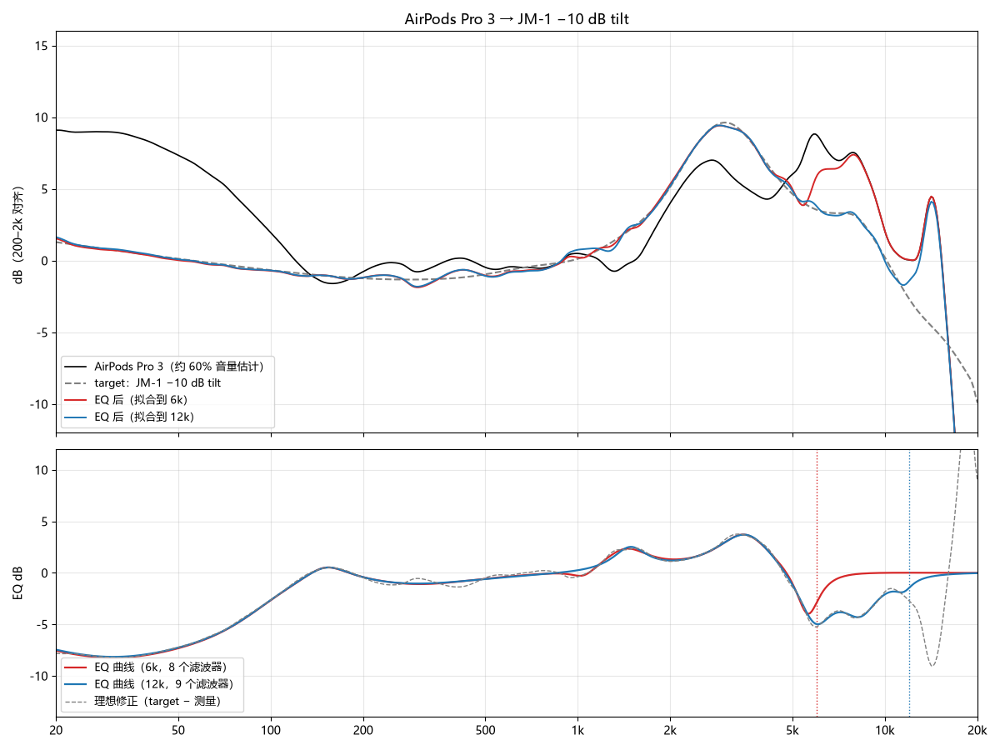
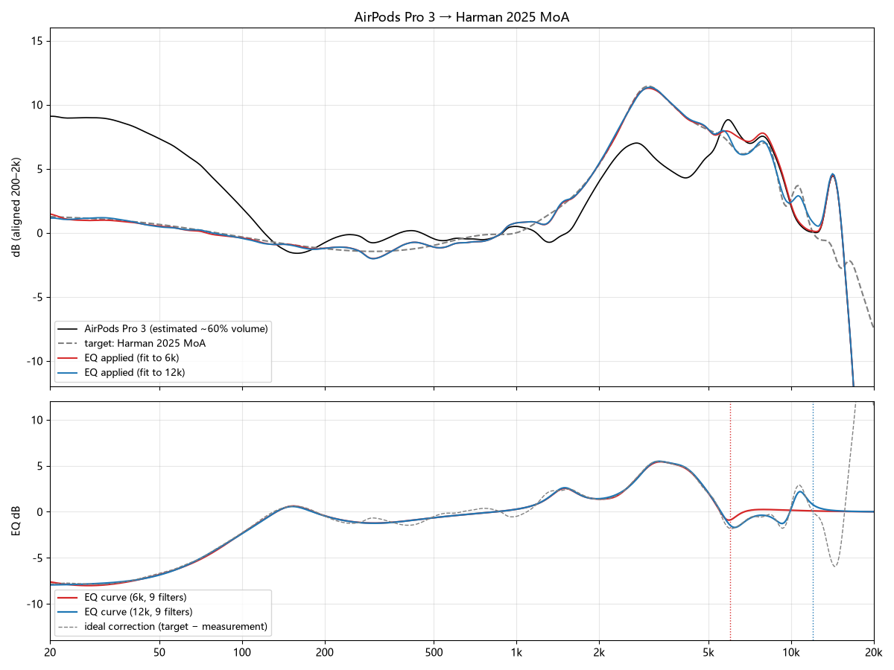
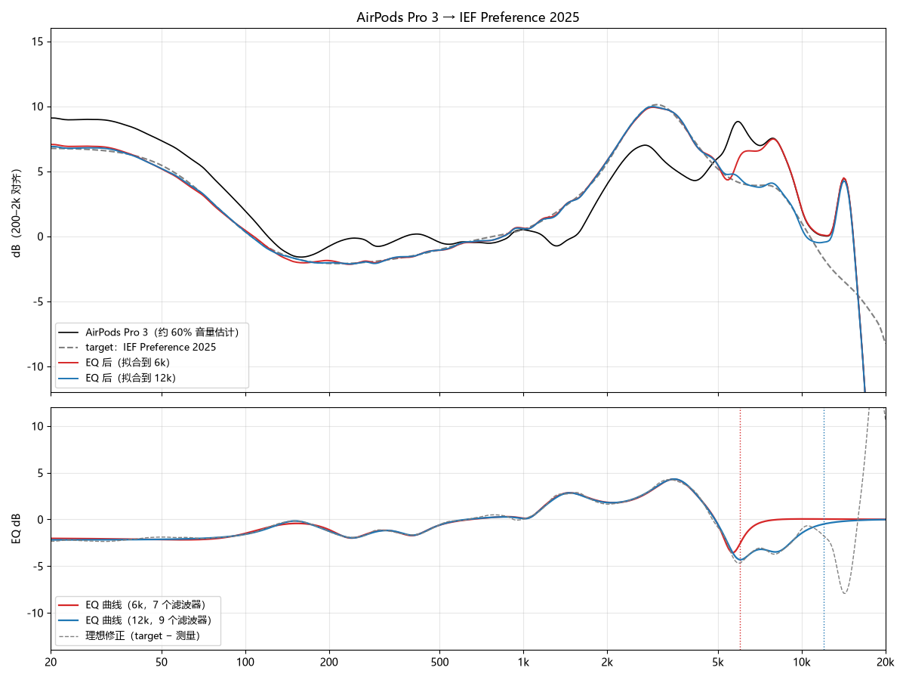
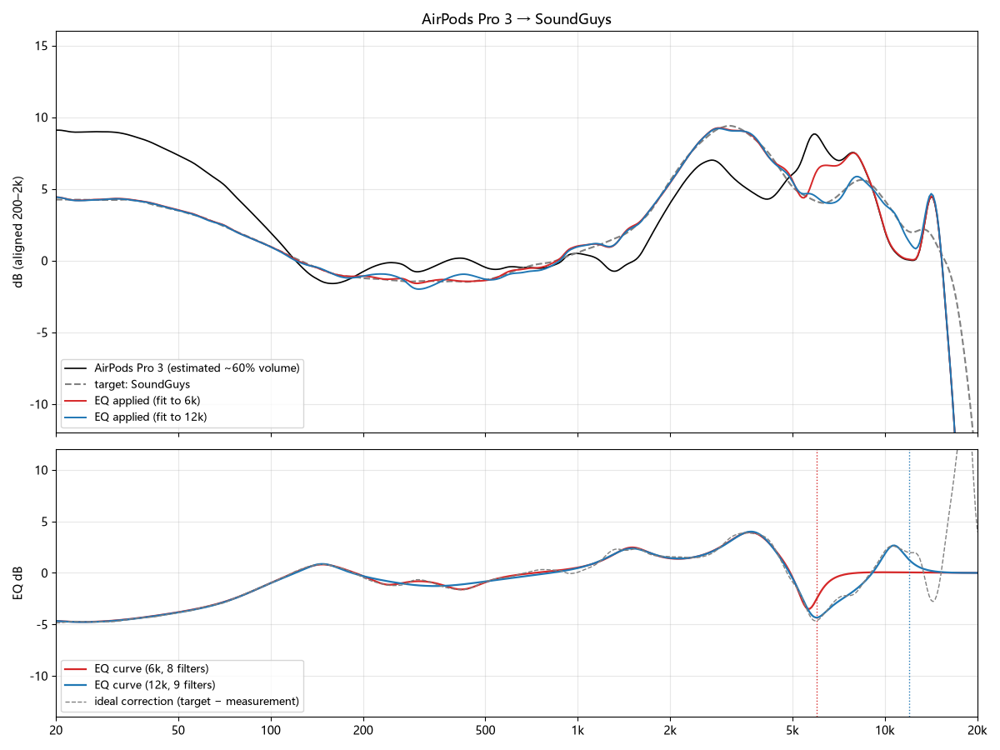

# AirPods Pro 3 PEQ（约 60% 音量，按 B&K 5128 测量拟合）

[English](README.md) | **中文**

把 AirPods Pro 3 的频响拟合到四条目标曲线上得到的参数式均衡器（PEQ）预设：JM-1 −10 dB tilt、Harman 2025 MoA、IEF Preference 2025 和 SoundGuys。每条目标各有 6 kHz 和 12 kHz 两个拟合上限版本。

测量曲线是多家 B&K 5128 数据综合出的约 60% 音量响应估算，不是对单副耳机的实测。

## 拟合结果

每张图包含：估计测量（黑）、目标曲线（灰色虚线）、6 kHz 版 EQ 后的响应（红）、12 kHz 版 EQ 后的响应（蓝），以及 EQ 曲线和理想修正（目标 − 测量）。

### JM-1 −10 dB tilt

### Harman 2025 MoA

### IEF Preference 2025

### SoundGuys

## 文件

| 路径 | 内容 |
|---|---|
| `presets/*.txt` | PEQ 滤波器，Equalizer APO 格式（`Preamp` + `Filter N: ON ...`） |
| `plots/fit_*.png` | 每条目标的拟合结果 |

命名规则：`<目标>_<上限>.txt`，例如 `Harman25_12k.txt` 是 Harman 2025 MoA 目标拟合到 12 kHz。

## 使用

1. 把预设导入支持 Equalizer APO 格式的均衡器，例如 Windows 上的 Equalizer APO 或 Peace。
2. 同时设置 `Preamp`，为提升的频段留出余量。
3. 12 kHz 版本覆盖整个拟合范围。6 kHz 版本在 6 kHz 以上保持原样。
4. 比较预设时保持音量不变。预设按粉红噪声做了等响度对齐，听感上仍有约 ±0.5 dB 的差异。

## 目标曲线

| 预设前缀 | 目标 | 说明 |
|---|---|---|
| `JM1-10dB_*` | JM-1 −10 dB tilt | JM-1 5128 目标加 −1 dB/oct 倾斜，比原版 JM-1 更暗 |
| `Harman25_*` | Harman 2025 MoA | Harman 2025 年的平均目标 |
| `IEF25_*` | IEF Preference 2025 | JM-1 的偏好版，低频更多，高频更少 |
| `SoundGuys_*` | SoundGuys | SoundGuys 的 5128 目标 |

目标数据归各自的发布方所有。

## 数据来源

| 来源 | 网址 | 用途 |
|---|---|---|
| earphonesarchive | https://earphonesarchive.squig.link/ | AirPods Pro 3 的 B&K 5128 测量（iPhone、vol-4、ANC 开/关、通透），以及部分目标 |
| Hangout / Crinacle 5128 | https://graph.hangout.audio/iem/5128 | AirPods Pro 3 的 B&K 5128 测量（macOS、Windows、多次佩戴），以及 JM-1、Harman 2025、IEF 2025、SoundGuys 目标 |
| headphones.com GraphWorks | [headphones.com](https://headphones.com/)（产品 slug `airpods-pro-3`） | 16 个音量档的 5128 测量（测量 ID `cmqtqbexe000004jv2mqogkh0`） |

数据拉取于 2026 年 11 月。

## 方法

- **测量基线**：上述来源的 5128 测量在 200 Hz–2 kHz 对齐后取平均，再按各来源观察到的音量变化调整到约 60% 音量。
- **拟合目标**：目标 − 测量，只拟合经 1/6 倍频程平滑后的误差。
- **滤波器**：1 个低架加 8 个峰值滤波器。拟合上限以上 EQ 为 0 dB。
- **正则化**：每 dB 增益 0.3 的平方惩罚。拟合后合并重复滤波器（同频率、同 Q），再精修一次。
- **误差**：拟合范围内各段 RMS 多在 0.1–0.6 dB。12 kHz 版本的 10–12 kHz 段约 0.6 dB。

## 限制

- 只有一种测量条件：原装耳塞套、开降噪、约 60% 音量。换耳塞套、关降噪或改变音量，响应会不同。
- 每条目标都代表一种调音取向。
- 10 kHz 以上各来源差异很大，这一段的修正最不可靠。6 kHz 版本不处理这一段。

## 许可

待定。
