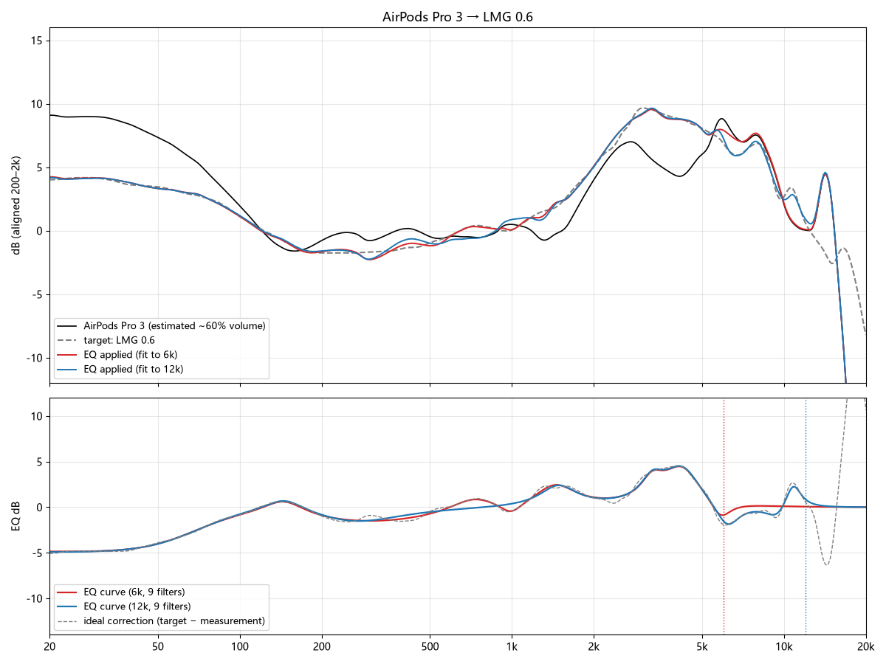

# AirPods Pro 3 PEQ（约 60% 音量，按 B&K 5128 测量拟合）

[English](README.md) | **中文**

把 AirPods Pro 3 的频响拟合到几条常见目标曲线上得到的参数式均衡器（PEQ）预设：LMG 0.6、JM-1 −10 dB tilt、Harman 2025 MoA、IEF Preference 2025 和 SoundGuys。每条目标都有 6 kHz 和 12 kHz 两个拟合上限的版本。

> **注意**：这里用的测量曲线是多家 B&K 5128 数据综合出来的 **约 60% 音量估计**，不是对你这副耳机的实测。固件版本、耳塞套、佩戴位置、降噪状态和音量都会改变响应。请把这些预设当作起点，而不是标准答案。

## 拟合结果

每张图包含：估计测量（黑）、目标曲线（灰色虚线）、6 kHz 版 EQ 后的响应（红）、12 kHz 版 EQ 后的响应（蓝），以及 EQ 曲线和理想修正（目标 − 测量）。

### LMG 0.6

### JM-1 −10 dB tilt

### Harman 2025 MoA

### IEF Preference 2025

### SoundGuys

## 文件

| 路径 | 内容 |
|---|---|
| `presets/*.txt` | PEQ 滤波器，Equalizer APO 格式（`Preamp` + `Filter N: ON ...`） |
| `plots/fit_*.png` | 每条目标的拟合结果 |

命名规则：`<目标>_<上限>.txt`，例如 `LMG06_12k.txt` 表示 LMG 0.6 目标，拟合到 12 kHz。

## 使用

1. 把预设导入支持 Equalizer APO 格式的均衡器（Windows 上的 Equalizer APO、Peace 等）。Android 上不是每个 App 都支持这个格式，用之前先确认。
2. 同时设置 `Preamp`。它为提升的频段留出余量，避免削波。
3. 建议先用 12 kHz 版本。6 kHz 版本在 6 kHz 以上完全不修正，更保守。
4. 比较不同预设时，**音量保持不变**。预设已经做过等响度对齐，但对齐是按粉红噪声估算的，听感上差 ±0.5 dB 很正常。

## 目标曲线

| 预设前缀 | 目标 | 说明 |
|---|---|---|
| `LMG06_*` | LMG 0.6 | LTT Labs 的 B&K 5128 目标，偏向"偏好"取向 |
| `JM1-10dB_*` | JM-1 −10 dB tilt | JM-1 5128 目标加上 −1 dB/oct 倾斜，比原版 JM-1 更暗 |
| `Harman25_*` | Harman 2025 MoA | Harman 2025 年的平均目标 |
| `IEF25_*` | IEF Preference 2025 | 基于 JM-1 的偏好版，低频提升、高频降低 |
| `SoundGuys_*` | SoundGuys | SoundGuys 的 5128 目标 |

目标曲线的数据版权归各自的发布方所有。这里只包含拟合后的 PEQ 参数，不包含原始目标数据。

## 数据来源（原始数据不在仓库中）

| 来源 | 网址 | 用途 |
|---|---|---|
| earphonesarchive | https://earphonesarchive.squig.link/ | AirPods Pro 3 的 B&K 5128 测量（iPhone、vol-4、ANC 开/关、通透），以及部分目标 |
| Hangout / Crinacle 5128 | https://graph.hangout.audio/iem/5128 | AirPods Pro 3 的 5128 测量（macOS、Windows、多次佩戴），以及 LMG 0.6、JM-1、Harman 2025、IEF 2025、SoundGuys 目标 |
| headphones.com GraphWorks | https://headphones.com/（产品 slug `airpods-pro-3`） | 16 个音量档的 5128 测量（测量 ID `cmqtqbexe000004jv2mqogkh0`） |
| squig.link | https://squig.link/ | 711 耳机耦合器测量。不是 5128，只用于估算音量变化带来的响应变化 |

没有记录各条目的深层链接，请在站内搜索 `AirPods Pro 3` 或 `5128`。数据拉取于 2026-11，之后站点数据可能有变化。

## 方法

- **测量基线**：多家 5128 测量在 200 Hz–2 kHz 对齐后综合，再用其他来源的音量变化估算到约 60% 音量。
- **拟合目标**：目标 − 测量，只拟合经 1/6 倍频程平滑后的误差。
- **滤波器**：1 个低架 + 8 个峰值滤波器。拟合上限以上的 EQ 保持为 0 dB。
- **正则化**：每 dB 增益 0.3 的平方惩罚，防止优化器把大的提升和衰减互相抵消。拟合后合并重复的滤波器（同频率、同 Q），再精修一次。
- **误差**：拟合范围内各段 RMS 多数在 0.1–0.6 dB。12 kHz 版本的 10–12 kHz 段约 0.6 dB。

## 未包含的内容

- 原始测量数据和原始目标 CSV（见上面的数据来源表）
- 带 MSEB 的版本（TempoTec V1 的低频 +2 dB、空气感 +2 dB 等）
- V4A 的 DDC 二进制文件（`.vdc`）

## 局限

- 只有一种测量条件：原装耳塞套、开降噪、约 60% 音量。换耳塞套、关降噪或改变音量，响应都会改变。
- 60% 音量的响应是**估算**，不是实测。
- 目标曲线本身有取舍。例如 LMG 0.6 里的"0.6"具体含义没有公开确认。选哪条目标取决于口味。
- 10 kHz 以上的修正依据较弱，各来源在这一段差异很大。6 kHz 版本更稳妥。

## 许可

待定。
